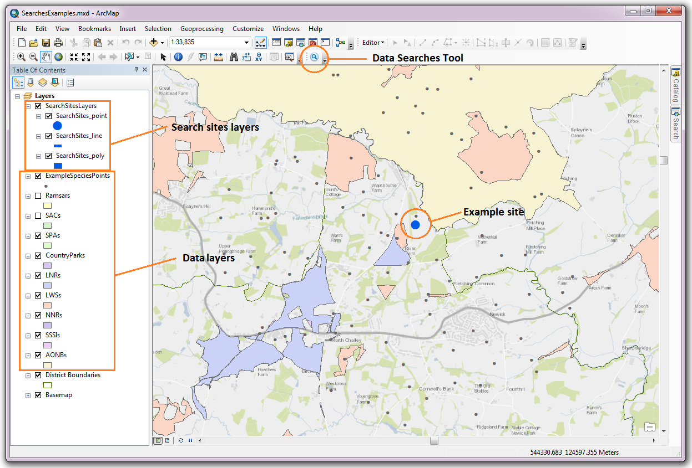
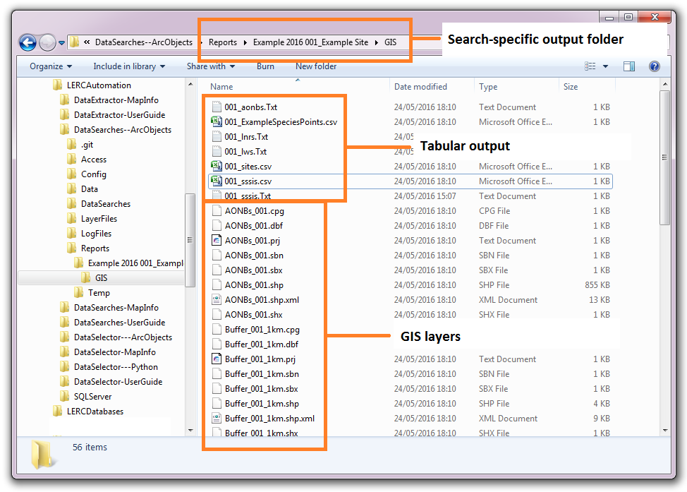

************************
Anatomy of a data search
************************

.. index::
   single: Data search process

Data search process
===================

A data search identifies protected sites, species or other features within
a specified distance of a location. A manual search normally involves:

1. Entering a point, line or polygon for the request and assigning its reference.
#. Buffering that location by the required radius.
#. Selecting intersecting features from each relevant data layer.
#. Exporting the required columns and GIS data, calculating summaries and
   preparing labels for maps.
#. Repeating the process for different radii or datasets where required.

The Data Searches tool automates these steps using saved configuration.
Users still need to check that the location, datasets, filters and results
are appropriate for the request.

The Data Searches tool
======================

The MapInfo tool has four main components:

* An open search-sites table containing request geometries and references.
* Open source tables containing the data to search.
* A launch XML file and one or more profiles defining searches and outputs.
* The compiled Data Searches application loaded in MapInfo.

An optional Access database supplies site names, organisations and partners.
It does not supply the search geometry. Without database lookup, site names
can be entered on the form.

A prepared workspace is illustrated in :numref:`figWorkspace`.

.. _figWorkspace:

   MapInfo workspace prepared for a data search

Tool workflow
-------------

1. Open the workspace, run the tool and choose a profile if prompted.
#. Enter the search reference and retrieve or enter the site name.
#. Select the data definitions to process and the buffer size and units.
#. Choose the retained GIS formats, map display, symbology, labels and combined
   sites options made available by the profile.
#. Start the search and wait for processing and any transfer to finish.
#. Review the log and outputs before preparing the response.

:numref:`figDisplayForm` highlights the main stages on the form.

The tool selects search features matching the reference and creates the
buffer. It then selects whole source-data features intersecting that buffer,
applies each definition's filters and exports its configured information.
The same source table can have several definitions for different outputs.

With ``WorkingDir`` configured, a fresh working subfolder holds the run's
outputs until they are moved to the final folder. Without it, files are
created directly in the final folder. Results are mapped after transfer.

Tool outputs
============

The following outputs support mapping and reporting.
:numref:`figResults` shows an example of mapped results in MapInfo.

GIS files
   TAB files and/or shapefiles can be retained for eligible layers. The original
   selected search features and buffer can be retained separately as TAB tables.
   Selected features keep their full geometry, rather than being clipped.

Tabular files
   CSV, TXT or DBF exports contain the configured fields and expressions.
   These can include search details, radius, distance expressions, overlap
   measurements and aggregate results. An optional script can format exports
   into XLSX files.

Combined sites table
   An optional retained TAB table combines selected information from several
   definitions and is exported to CSV, TXT or DBF. It can be appended to or
   overwritten. Appending does not remove duplicate records.

Log
   Records the profile, choices, processing steps, counts and errors. It is
   saved with the final outputs and opened in Notepad. A temporary journal
   can help recover information after interruption or a transfer failure.

Example map and output folder
-----------------------------

:numref:`figResults` identifies the main parts of the completed map.

:numref:`figOutputFolder` shows how the files are organised in the final folder.

.. _figOutputFolder:

   Final output folder and its MapInfo search files

Checking the outputs
--------------------

No new layer output is generated for an empty or over-limit selection. Old
output files can remain from earlier runs, so use the current log to establish
which files were produced. The next chapters describe
:doc:`../setup/setup` and :doc:`../execute/execute` in detail.
