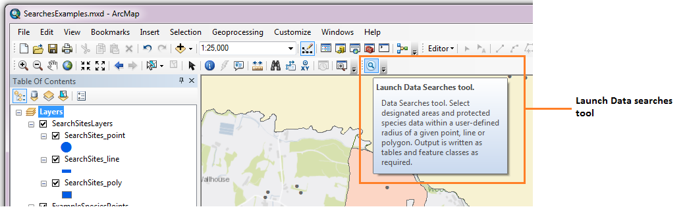
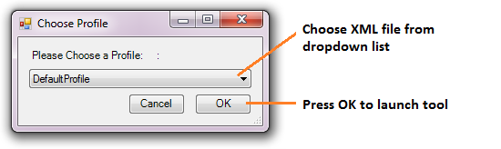
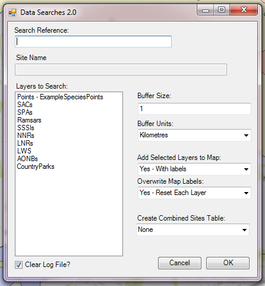
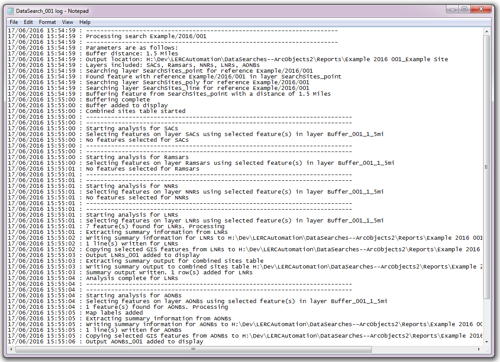
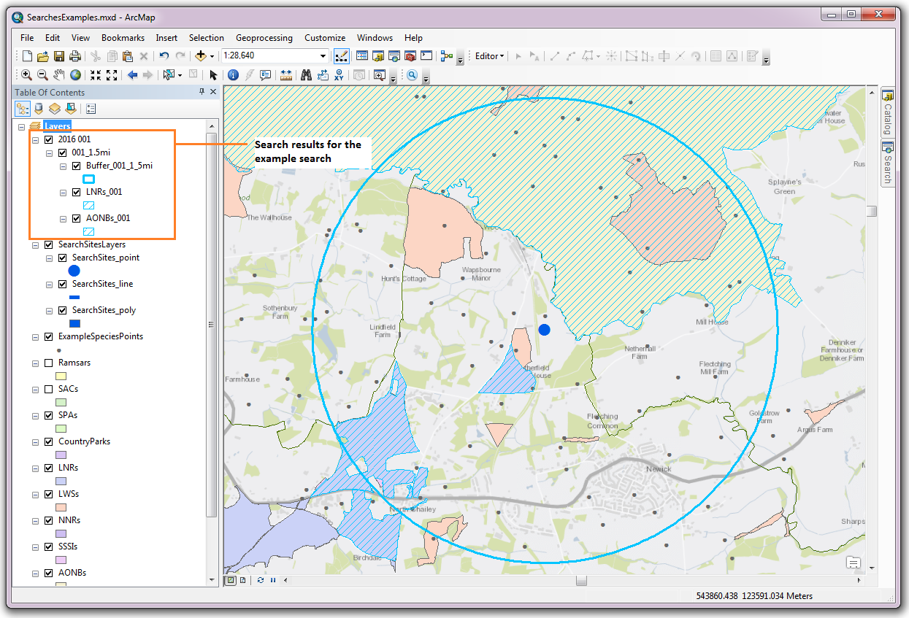

****************
Running the tool
****************

Before opening the form, load the workspace containing the configured
search-sites table and the source data tables. Ensure the chosen profile and
output locations are available. If lookup is enabled, the Access database
must also be available. See :doc:`../setup/setup` for configuration details.

Opening the form
================

In the classic interface, select **Tools --> Data Searches --> Run Data Searches**.
In the 64-bit ribbon interface, click **Data Searches** in the **Home** tab's
**Tools** group. The title may differ if ``ToolTitle`` has been customised.
:numref:`figToolMenu` in the setup chapter shows the classic menu route.

:numref:`figLaunchRibbon` shows the ribbon button.

.. _figLaunchRibbon:

   Launching Data Searches from the MapInfo ribbon

If several profiles are available, choose the required one. With one profile,
it is selected automatically. The profile controls the available tables and
the initial form settings. A source table that is not open is omitted from
the list, with a warning unless its ``LoadWarning`` is ``No``. The search-sites
table itself must be open or the form will not load.

:numref:`figChooseXML` shows profile selection. If a configured source table
is missing, open it in MapInfo and reopen the search form.

.. _figChooseXML:

   Choosing a profile in MapInfo

:numref:`figDisplayForm` identifies the controls used in the following steps.
The profile can hide optional controls; the illustrated profile shows them all.

.. _figDisplayForm:

   Annotated Data Searches form: reference, tables, buffer and output options

Using the form
==============

Search reference and site name
------------------------------

Enter the reference in **Search Ref**. With Access lookup enabled, click
**Find** to retrieve the site name, organisation and partner. The site-name
field is disabled in this mode; correct a missing or incorrect name in the
database, or use an administrator-prepared profile without lookup. Without
lookup, type the site name manually. The site name can be blank when
:ref:`RequireSiteName <requiresitename>` is ``No``.

The reference, **Find** button and site-name field are identified in
:numref:`figDisplayForm`.

The reference must identify the required features in the configured search
table. Text references use MapInfo ``LIKE`` matching and can contain wildcard
patterns. A pattern can select several search features; Access lookup uses
the first matching enquiry. Use a full reference for a single request.

Selecting tables and the buffer
-------------------------------

Highlight the definitions to process in **MapInfo Tables**. Use **Ctrl** for
individual selections or **Shift** for a range. Preselected definitions can
be deselected. At least one table must be selected.

Choose **Buffer Size** and **Buffer Units**. Zero uses the selected search
geometry without expanding it, including point or line geometry. Decimal
values can be entered, but the current buffer calculation treats values below
one unit as zero; use smaller units to express such a distance, for example
``500 m`` rather than ``0.5 km``. Blank or zero buffer defaults may hide these
controls. See :numref:`figDisplayForm` for the table list and buffer controls.

Adding results to maps
----------------------

**Add Selected Tables to Map** has these choices:

* **No**: do not add the selected data-layer outputs to maps.
* **Yes - Without labels**: add the retained outputs without requesting labels.
* **Yes - With labels**: add the outputs using each layer's label settings.

A definition with ``KeepLayer=No`` is not mapped. These choices do not control
the buffer and original search-feature layers: their own ``KeepBufferArea``
and ``KeepSearchFeature`` settings control retention and display.

Keeping GIS files
-----------------

**Keep Selected Tables** controls the saved GIS formats for definitions whose
``KeepLayer`` is ``Yes``:

* **None**: no retained GIS file, unless a TAB file is needed for map display.
* **TAB**: keep MapInfo TAB files and their associated files.
* **SHP**: create shapefiles using the configured Universal Translator.
* **BOTH**: keep TAB files and create shapefiles.

Map display retains a TAB file even when **None** or **SHP** is chosen.
Tabular exports and the combined sites table are controlled separately.
Keep all companion files together when moving TAB tables or shapefiles.

Applying symbology
------------------

**Apply Symbology to Tables** has three choices:

* **None**: do not apply configured symbology.
* **Layers only**: apply configured global display styles to mapped results,
  including retained buffer and search-feature layers.
* **Layers and tables**: also apply the profile's object-style rules to the
  saved buffer and search-feature tables.

The table-style rules apply to the buffer and search-feature sections. A data
layer's own ``Symbology`` value controls its display in map windows.

Labels
------

**Overwrite Map Labels** controls numbering in the selected output tables:

* **No**: retain existing label values.
* **Yes - Reset Each Layer**: restart numbering for each layer.
* **Yes - Reset Each Group**: request numbering by the group name before the
  hyphen in a layer definition; see the current limitation below.
* **Yes - Do Not Reset**: continue numbering across layers.

Each layer must allow overwriting and define a suitable ``LabelColumn``.
Numbering can also be used in tabular exports and the combined sites table;
it is not restricted to runs that display map labels. To display those values,
choose **Yes - With labels** under **Add Selected Tables to Map**.

.. note::
   The current implementation starts a reset sequence at 2 and does not reset
   the group counter as intended when changing groups. Use **Reset Each Layer**
   or **Do Not Reset** where predictable sequences are required, and check the
   generated values.

Combined sites table and log
----------------------------

**Create Combined Sites Table** offers:

* **None**: do not create or update it; existing output remains.
* **Append to existing table**: add rows to the existing TAB table, or create
  one if none exists. Only definitions with ``CombinedSitesColumns`` contribute.
* **Overwrite existing table**: create a fresh table, replacing the previous one.

Use a configured working root when appending: the current append operation
attempts a folder copy even when working storage is disabled.

Check **Clear log file?** to replace the previous final log, or leave it
unchecked to append this run's messages. It does not change output retention
or overwriting. Controls with blank profile defaults may be hidden, using
the initial **No** or **None** choice.

Starting and finishing a search
===============================

Click **Ok** to start. Wait for processing and any file transfer to finish.
The tool selects matching search features, creates the buffer, processes the
selected definitions and generates the configured outputs.

If a :ref:`working folder <working_directory>` is configured, outputs are
created in a fresh run folder and then moved to the final GIS folder before
map display. Otherwise processing writes directly to the final folder. Local
working storage does not remove the requirement for access to the final folder.

When prompted **Do you wish to close the form?**, choose **No** to retain the
current selections for another run. The final log opens in Notepad. Check it
for errors, skipped layers, selection counts, export counts and transfer
messages before using the results. A completion message does not establish
that every layer, formatting script or shapefile conversion succeeded.

:numref:`figLogFile` shows the saved log opened for review.

.. _figLogFile:

   Reviewing the final MapInfo search log in Notepad

.. _OverwriteWarning:

.. caution::
   Reusing output names can replace files from a previous run. Names depend
   on the profile, not just the search reference. Include ``%radius%`` in
   output names or move earlier results if both searches must be kept.

   Appending the same layer again can duplicate combined sites records.
   Overwrite replaces the combined table; append does not remove duplicates.
   A layer producing no new output does not clear older files with that name.

Search results
==============

Final outputs are stored beneath ``SaveRootDir``, then ``SaveFolder`` and
``GISFolder`` where those are non-blank. Depending on the profile and choices,
they include CSV, TXT or DBF exports, TAB and/or SHP data, retained search and
buffer tables, the combined sites TAB table and export, optional formatted
XLSX files, and logs.

Spatial selection copies whole data features that intersect the buffer; it
does not clip their geometry. Export expressions can calculate overlap areas.
If a selection is empty or exceeds ``RecMax``, the layer is skipped and logged.

Mapped output is added to each map window containing its source layer. If
none contains it, the tool attempts to use the active map window. Results are
placed in the configured group. Retained buffer and search-feature layers
are added separately, and the map view is adjusted to the buffer extent.

:numref:`figResults` identifies the results group, output layers, labels and
retained search and buffer features in MapInfo.

.. _figResults:

   Annotated MapInfo search results and retained search geometry

.. _transfer_recovery:

Interrupted runs and transfer failures
======================================

Version 1.4.47 keeps each working run separate. Starting again uses a fresh
folder; it does not resume, clear or move the failed run's files.

If a move fails, mapping stops. Record the source and destination shown in
the log and check both: some files may have moved successfully. Robocopy
retries failures three times with a two-second delay; an exit code of 8 or
higher, or failure to launch it, is treated as a transfer failure.

Restore access to the destination or release file locks, then decide whether
to recover the retained files or rerun the search. Close affected tables before
manual recovery, and move complete TAB or SHP file sets together. Check the
combined sites table before choosing append again after a partial transfer.
Keep failed-run folders until recovery is complete; remove them manually only
when their contents are no longer needed.

If the final log cannot be written, the tool reports its path and the temporary
journal path and retains pending messages in memory. Restore access and retry
while the tool remains open. A new search is prevented while pending messages
cannot be written. If necessary, copy the temporary journal before closing
MapInfo; messages held only in memory do not survive closing the application.
