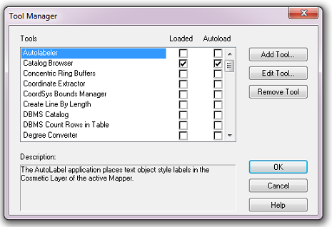
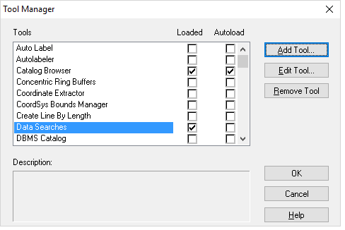
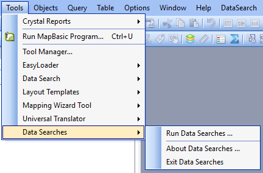
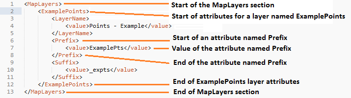

*******************
Setting up the tool
*******************

This chapter describes Data Searches for MapInfo version 1.4.47. Configure
the tool before making it available to users, and back up existing profiles
when upgrading.

.. index::
   single: Installation

Installing the tool
===================

Use the compiled application supplied for your MapInfo version and its 32-bit
or 64-bit edition. Copy the application and its supplied support files to the
installation folder. Keep ``DataSearches.xml``, the profile XML files and the
supplied ribbon icons with the application. Source files alone are not a
runnable installation.

Load the application using MapInfo's **Tool Manager** or **Tools** window.
In the classic interface, choose **Tools --> Tool Manager**, select
**Add Tool**, browse to the application and enter a title. Select **Loaded**
to load it now and **AutoLoad** to load it whenever MapInfo starts. These
illustrations show the classic interface; ribbon editions have a different layout.
See :numref:`figToolManager` for Tool Manager and :numref:`figAddTool` for
the Add Tool dialog.

.. _figToolManager:

   Tool Manager in the classic MapInfo interface

.. _figAddTool:

.. figure:: figures/AddToolDialog.png
   :align: center

   Adding the Data Searches application

After adding the application, check its **Loaded** and **AutoLoad** settings
as shown in :numref:`figToolAdded`.

.. _figToolAdded:

   Data Searches loaded in the classic Tool Manager

The classic interface adds a **Data Searches** menu under **Tools**, with
**Run**, **About** and **Exit** commands. The 64-bit ribbon interface adds a
button in the **Home** tab's **Tools** group. Its title comes from ``ToolTitle``
in the launch configuration. The classic menu is shown in
:numref:`figToolMenu`.

.. _figToolMenu:

   Data Searches commands in the classic Tools menu

.. tip::
   Save a workspace containing the search-sites table and all source tables
   required by the profiles. Open these before opening the search form, and
   include the search-sites table in a map window.

Requirements and folder access
------------------------------

Users need access to the installation, source data and final output folders.
The search-sites table must be writable: MapInfo uses it temporarily during
buffer creation and commits pending edits before that step. Save or discard
other edits before running the tool.

Database lookup needs a readable Access database, a writable ``EnquiriesDir``
and suitable database drivers. If ``WorkingDir`` is configured, it must be
writable and Windows ``robocopy.exe`` must be available. SHP output requires
the Universal Translator configured by ``UTPath`` and ``UTCommand``. An optional
export ``Macro`` requires Windows Script Host and any software used by the script.

.. index::
   single: Configuring the tool
   single: XML; Profiles

.. _configuration:

Configuring the tool
====================

Keep both parts of the configuration alongside the compiled application:

* ``DataSearches.xml`` is the launch configuration. Its ``DataSearches`` node
  contains ``ToolTitle`` and ``DefaultProfile``.
* A profile, usually ``DefaultProfile.xml``, contains the general settings and
  ``MapTables`` definitions under its own ``DataSearches`` node.

One profile is used automatically. With several XML files other than
``DataSearches.xml``, the tool asks the user to choose. Keep unrelated XML files
out of the application folder. ``DefaultProfile`` sets the initially selected
file; include ``.xml``. If blank, the default is ``DefaultProfile.xml``.

.. caution::
   Keep the launch file name ``DataSearches.xml``. The tool excludes it from
   the profile list, so a separate profile is required. Preserve node names
   and their case.

Edit XML in a text or XML editor. A setting normally has the form
``<Example><value>setting</value></Example>``. Closing tags use a forward slash.
Check the XML for well-formedness after editing; valid XML can still contain
incorrect paths, table names or SQL. The appendix provides
:ref:`downloadable examples <example_xml>`.

Special characters in XML
-------------------------

Within values, escape ``<`` as ``&lt;`` and ``&`` as ``&amp;``. Escaping ``>``
as ``&gt;`` is also good practice. For example::

   <SelectCriteria>
       <value>Year &gt; 2010 And Status &lt;&gt; "Confidential"</value>
   </SelectCriteria>

The XML reader restores these characters before passing the expression to
MapInfo. Double quotes within element text do not need escaping.

.. index::
   single: XML; Variables

.. _naming_variables:

Naming variables
----------------

These variables work in ``SaveFolder``, ``GISFolder``, ``LogFileName``,
``BufferSaveName``, ``SearchFeatureName``, ``GroupLayerName``, each layer's
``GISOutputName`` and ``TableOutputName``, and the combined sites
``TableOutputName``. Use the lower-case spellings shown.

.. list-table::
   :header-rows: 1
   :widths: 26 74

   * - Variable
     - Meaning
   * - ``%ref%``
     - Full search reference entered on the form.
   * - ``%shortref%``
     - Numeric part of the reference, with separators processed for names.
   * - ``%subref%``
     - Final part of the processed numeric reference.
   * - ``%sitename%``
     - Site name entered or retrieved from the database.
   * - ``%organisation%``
     - Organisation retrieved using ``OrgColumn``.
   * - ``%partner%``
     - Partner retrieved using ``PartnerColumn``.
   * - ``%radius%``
     - Buffer size and unit abbreviation; decimal points become underscores
       in names, for example ``1_5km``.

For ``XYBRC/2026/001``, ``%subref%`` normally gives ``001``. ``%shortref%``
depends on ``RepChar`` and separator processing: check representative names.
Special characters are replaced and spaces in GIS table names become underscores.
Specify complete output names; a reference is not added automatically.
Variables are not expanded in ``WorkingDir`` or ``SaveRootDir``.

General profile settings
========================

Database and search tables
--------------------------

Debug
   ``Yes`` adds diagnostic messages to the log.

Database
   Full Access database path, including its extension. Leave blank to run
   without lookup and enter the site name manually.

EnquiriesDir
   Writable folder for the Access table's ``Enquiries.tab`` registration.

EnquiriesTable
   Table inside the Access database, for example ``Enquiries``.

RefColumn
   Reference column used in both the Access table and ``SearchTable``. Use
   the same column name in both. Text references support MapInfo ``LIKE`` patterns.

SiteColumn, OrgColumn, PartnerColumn
   Access columns holding the site name, requester organisation and partner.
   Leave unused names blank. The optional search-table update uses these names too.

RadiusColumn
   Search-table column intended to receive the buffer size and units during
   an optional update. It does not retrieve a radius from Access. Leave blank
   if unused.

.. _requiresitename:

RequireSiteName
   ``Yes`` requires a site name; ``No`` permits a blank. With lookup enabled,
   the site-name control is disabled and **Find** retrieves the name. Without
   lookup the field is editable.

SearchTable
   Open MapInfo table containing the search locations. One profile uses one
   search table; several matching features can be selected. Its reference
   column is ``RefColumn``. ``SearchColumn`` is not read by the current tool.

AggregateColumns
   MapBasic ``Data`` assignments used when creating the buffer, for example
   ``EnquiryRef=EnquiryRef, SiteName=SiteName``. Preserve fields needed by
   buffer-based export expressions. This is not just a list of field names.

UpdateTable
   Controls the optional attempt to update search-table attributes from lookup
   values and the radius. Set explicitly to ``No`` unless this operation has
   been checked for your installation; see :doc:`the running instructions <../execute/execute>`. It does
   not make the table read-only during buffering.

Output folders and logging
--------------------------

RepChar
   Replacement for special characters in generated names. A space is allowed.
   Choose a character suitable for Windows file names and MapInfo table names.

SaveRootDir
   Full final output root, such as ``D:\DataSearches\Reports`` or a UNC path.

SaveFolder
   Request folder beneath the root. Supports :ref:`naming_variables`.
   Leave blank to use the root directly.

GISFolder
   Output folder beneath the request folder. Supports naming variables.
   Leave blank to use the request folder directly.

.. _working_directory:

WorkingDir
   Optional working root, preferably local when final outputs are on a network.
   Each run creates a fresh subfolder beneath it. Interrupted runs are retained
   and are neither cleared nor included in later runs. Leave blank or omit
   this setting to process directly in the final GIS folder. The working run
   folder and final folder must not overlap.

   After processing, saved tables are committed and closed and Robocopy moves
   the current run's files to the final GIS folder before results are mapped.
   Matching outputs are replaced; unrelated destination files are retained.
   For an append, the existing combined sites table is copied into the fresh
   working folder first.

   A failed move stops mapping and retains untransferred files. A partial move
   can leave files in both locations. The log identifies both folders. See
   :ref:`transfer_recovery` before retrying.

LogFileName
   Final log name, including an extension such as ``.log``. Supports naming
   variables. A temporary journal adds ``_tmp`` before the extension.

DefaultClearLogFile
   ``Yes`` initially checks **Clear log file?**; ``No`` appends to the final
   log. This setting does not control output overwriting.

Buffer and search-feature settings
----------------------------------

DefaultBufferSize
   Initial buffer size. Blank or zero hides the size control and uses zero.
   See :doc:`the running instructions <../execute/execute>` before configuring radii below one unit.

BufferUnitOptions
   Display-name and MapInfo-unit pairs separated by ``$``, with ``;`` between
   each name and abbreviation, for example ``Metres;m$Kilometres;km$``.

DefaultBufferUnit
   One-based position in ``BufferUnitOptions``. Blank hides the control; the
   code then uses position 3 internally, so retain a valid third option.

KeepBufferArea, KeepSearchFeature
   ``Yes`` retains the buffer or selected search features as TAB files and adds
   them to map windows. ``No`` removes the corresponding temporary table.
   These are separate from the data-layer retention and mapping choices.

BufferSaveName, SearchFeatureName
   Retained table names without extensions. Supports naming variables.

BufferSymbology, SearchAreaSymbology
   MapBasic global display styles for the buffer and search-feature layers,
   applied for **Layers only** or **Layers and tables**. Follow the example
   profile's syntax.

Buffer, SearchArea
   Optional sections with ``Symbology`` rules for saved object styles. Each
   ``Symbol`` rule has ``Clause`` (filter, or blank for all), ``Object``
   (``Region``, ``Line`` or ``Point``), and the appropriate ``Pen`` and ``Brush``,
   ``Pen``, or ``Symbol`` values. Each value uses a ``value`` child element.
   Rules apply to saved buffer and search-feature objects for **Layers and tables**.

CoordinateSystem
   Existing profiles may contain this setting. The current source reads it
   but does not apply a coordinate-system command. Configure source tables
   appropriately rather than relying on this setting to reproject output.

RecMax
   Maximum spatially selected record count for each layer. Exceeding it skips
   the whole layer and logs the reason; it does not truncate the selection.
   Set a positive limit suited to your data and MapInfo's table-size limits.

Form defaults and map display
-----------------------------

Options are positional. Keep their order as shown; changing the wording does
not change the behaviour assigned to each position. Defaults are one-based.

AddSelectedTablesOptions, DefaultAddSelectedTables
   ``No;Yes - Without labels;Yes - With labels``. Blank default hides the
   control and uses **No**.

KeepSelectedTablesOptions, DefaultKeepSelectedTables
   ``None;TAB;SHP;BOTH``. Blank default hides the control and uses **None**.
   The layer also needs ``KeepLayer=Yes``. Requesting map display retains its
   TAB file even for **None** or **SHP**.

ApplySymbologyOptions, DefaultApplySymbology
   ``None;Layers only;Layers and tables``. Blank default hides the control
   and uses **None**. Layer styles affect displayed results; table styles
   affect saved buffer and search-feature objects.

GroupLayerName
   Results group name in map windows. Supports naming variables.

OverwriteLabelOptions, DefaultOverwriteLabels
   ``No;Yes - Reset Each Layer;Yes - Reset Each Group;Yes - Do Not Reset``.
   Blank default hides the control and uses **No**. Numbering also affects
   output attributes, subject to each layer's ``OverwriteLabels`` setting.

CombinedSitesOptions, DefaultCombinedSitesTable
   ``None;Append to existing table;Overwrite existing table``. Blank default
   hides the control and uses **None**. Configure a separate ``WorkingDir``
   before appending to an existing table; see :doc:`the running instructions <../execute/execute>`.

CombinedSitesTable
   Defines the combined sites TAB table and its tabular export:

   TableName
      Internal TAB name, without extension, for example ``Sites``. Keep it
      distinct from source and other output table names.
   Columns
      Ordered MapBasic column definitions with types and lengths, for example
      ``Site_Type Char(20), Site_Name Char(100), Map_Label Char(10)``.
   TableOutputName
      Export base name, supporting naming variables, for example ``%subref%_sites``.
      The former ``Suffix`` setting is not read.
   Format
      ``csv``, ``txt`` or ``dbf``. CSV has headings; TXT is comma-delimited
      without headings. The TAB table is retained for future appends.

UTPath, UTCommand
   Folder and executable of the installed Universal Translator for SHP output,
   for example the MapInfo ``UT`` folder and ``Fme.exe``. Older installations
   may use ``Imut.exe``. Conversion errors are logged.

.. index::
   single: Map layer attributes

Map layer settings
==================

Each child of ``MapTables`` defines a search. ``Sites_-_SSSIs`` appears as
**Sites - SSSIs**: underscores become spaces. The part before a hyphen supplies
the logical group for label numbering. Several definitions can use the same
source table with different filters. :numref:`figXMLExample` illustrates
the current XML structure for one definition.

.. _figXMLExample:

   Annotated MapInfo MapTables configuration example

TableName
   Source table name as it is open in MapInfo, without path or extension.

GISOutputName
   GIS file base name for TAB and SHP output. Supports naming variables.
   The former ``Prefix`` setting is not read.

TableOutputName
   Tabular export base name without extension. Supports naming variables.
   The former ``Suffix`` setting is not read.

Columns
   Comma-separated MapInfo SQL expressions for export, including source fields,
   calculated expressions, aggregates with aliases and :ref:`export_expressions`.
   Blank ``Columns`` or ``Format`` skips tabular export without preventing
   GIS or combined sites output.

SelectCriteria
   Optional condition applied with the spatial selection, for example
   ``Year > 2010 And Confidential <> "Y"``. Omit any leading ``Where`` or
   ``And``: the tool adds ``And (...)``. Escape XML special characters.

ExportCriteria
   Extra SQL after the export spatial condition, commonly
   ``Group By ... Order By ...``. Further filters must begin with ``And``.

KeyColumn
   Optional source column for ordering and assigning consistent label numbers
   to records sharing a key. Numeric keys are supported.

Format
   ``csv``, ``txt`` or ``dbf``. CSV has column headings; TXT is comma-delimited
   without headings. Exports use the WindowsLatin1 character set.

Macro
   Optional full path to a Windows Script Host script run after export. It
   receives the working folder, exported file name and expected XLSX file name
   as three arguments. A non-zero exit or missing XLSX is reported. Leave blank
   if no script is required.

KeepLayer
   ``Yes`` allows GIS retention and mapping; ``No`` removes GIS output after
   tabular export and combined sites processing. Formats follow **Keep Selected
   Tables**. Empty or over-limit selections do not produce new outputs.

LoadWarning
   ``No`` suppresses warnings for a source table that is not open. It remains
   excluded from the form.

PreselectLayer
   ``Yes`` highlights this definition on opening the form. Users can change it.

OverwriteLabels
   ``Yes`` allows the form's overwrite option to number the output label column.
   ``No`` preserves existing values. Changes affect output, not source data.

LabelColumn
   Column used for labels; it must exist or be successfully created in output.
   For sequential numbers, use ``OverwriteLabels=Yes`` and an overwrite option.
   Do not rely on a missing column being numbered when overwriting is disabled.

LabelClause
   MapBasic label clause, for example
   ``Font ("Arial",0,10,0) With Map_Label Auto On``. When blank and a valid
   ``LabelColumn`` exists, the current tool uses ``With LabelColumn``. Use an
   explicit clause to control appearance and visibility.

Symbology
   Global display style applied when the output is mapped and symbology is
   enabled, for example
   ``Global Pen (2,2,16711680) Global Brush (1,16777215,16777215)``.
   This is a single ``value``, unlike the ``Buffer`` and ``SearchArea`` rules.

CombinedSitesColumns
   Expressions inserted into ``CombinedSitesTable``. Their count, order and
   types must match its ``Columns``. Blank excludes this layer. Quoted text
   can identify the source, for example ``"SSSI", SiteName, Map_Label``.

CombinedSitesCriteria
   Extra SQL for combined sites selection, commonly ``Group By ...`` or
   ``Order By ...``. Start additional filters with ``And``. This is independent
   of ``ExportCriteria``.

.. note::
   Historical comments mention ``OutputType``, but the current profile reader
   does not read it. Selected GIS features are copied in full when they
   intersect the buffer; that setting does not clip their geometry. Overlap
   expressions can report intersecting areas.

.. _export_expressions:

Export expressions and measurements
===================================

``Columns`` and ``CombinedSitesColumns`` accept the lower-case search variables
listed under :ref:`naming_variables`. Variables become quoted values: do not
quote the variable itself. Supply aliases where needed, for example
``%radius% "Radius"`` or ``%ref% "SearchRef"``. Radius values here retain their
decimal point, for example ``1.5km``.

.. list-table::
   :header-rows: 1
   :widths: 28 72

   * - Expression
     - Result
   * - ``%overlap%`` or ``%overlaparea%``
     - Selected source-feature area overlapping the buffer, in hectares.
   * - ``%searcharea%``
     - Buffer/search area, in hectares.
   * - ``%searchlen%``
     - Buffer/search object length, in metres.
   * - ``%inputarea%``
     - Full selected data-layer feature area, in hectares.
   * - ``%inputlen%``
     - Selected data-layer feature length, in metres.
   * - ``%searchlayer%``
     - Buffer table name, for attribute expressions such as
       ``%searchlayer%.EnquiryRef "SearchRef"``.

For overlap length, use ``%overlapLen%`` in ``Columns`` and ``%overlaplen%`` in
``CombinedSitesColumns``; the spellings differ in the current code. Measurements
depend on geometry type. The ``input`` expressions refer to selected data-layer
features, not the original search-site polygon.

During ordinary export expressions the selected data table is ``Select_Table``
and the buffer is ``Buffer_Area``. Qualify ambiguous field names. Preserve any
buffer attributes needed by expressions through ``AggregateColumns``.

.. caution::
   Keep XML nodes and variables exactly as shown. Check profiles with
   representative data, empty selections, repeated runs and combined sites
   appends before making them available to users.
